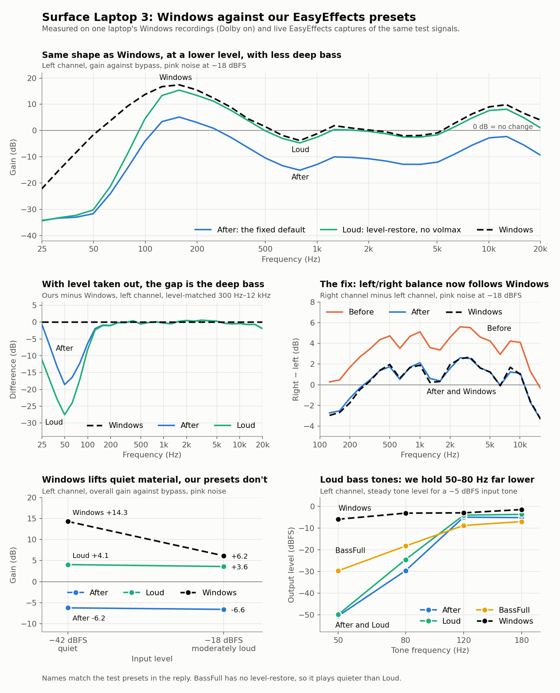

# Vendor APO layers: Dolby DAX2 registry presets

[reference.md](../../reference.md) covers what the converter emits, and
[vendor-apo.md](../vendor-apo.md) where the vendor APO layers stand.

## Dolby DAX2 registry presets: the tuning a driver .inf writes

Some drivers write the device's Dolby tuning into the registry, in the older
DAX2 format, instead of shipping a DAX3 XML: 47 numbered endpoint properties,
seven of them arrays, four of which carry their own frequency grid. The arrays
match DAX3's IEQ, audio-optimizer, graphic-EQ, regulator and virtual-bass
fields by shape. A DAX3 preset written the same way names five of the single
values, each matching one field of a DAX3 XML, and the volume leveler's two
targets as a pair. Conditions: Surface Laptop 3 13.5" Intel (issue #148),
`SurfaceLaptop3_Intel_Win11_22000_24.080.2664.0.msi` (SHA-256 `15910385…`),
`HDXSSTM2.inf` DriverVer 6.0.9249.2, `DAP_CPDP_VERSION` 2.0.1, codec ALC274
`10EC11B2`. The key between the formats: Surface Go 3
`SurfaceGo3_Win11_22631_26.080.320.0.msi` (SHA-256 `41983621…`), `HDXHAPM.inf`
6.0.9157.2 `[DAX3Tuning_11CE.AddReg]` against
`Headphone_Default_Generic_Default_DolbyAudioPremium.xml` from the same MSI.
Read 2026-10-25.

**The binding.** The codec's hardware ID, such as
`HDAUDIO\FUNC_01&VEN_10EC&DEV_0274&SUBSYS_10EC11B2`, names an install section.
Its AddReg sections set `OEMSettingsOverride` on each endpoint topology to a
preset key, and write the preset under `InterfaceSetting\<preset>\EP\0` as
`{f112024a-fe30-42a8-80ab-8dd825a06f78},N`. The section and file names are the
OEM's (`DAX2Tuning_11B2.AddReg`, but most codecs bind presets written elsewhere
in the file). One `.inf` holds the presets for every codec it binds, and codecs
share preset keys. The speaker and headphone presets hold different values, and
only the name says which endpoint a preset is for (`…_SPK`, `…_HP`). Each
Surface package whose file list was checked ships Dolby's `DolbyDAX2APO*.dll` in
the folder of the `.inf` carrying the property set
([fleet](#r-dolby-registry-fleet)).

| Container | Layout (fits every preset read) |
|---|---|
| value | REG_BINARY: an 8-byte PROPVARIANT header, u16 type first, then 32-bit little-endian integers |
| type 3 | one int32 |
| type 0x41 | int32 blob: `n`, then arrays of `n` values, each prefixed by its count `n`; or, for the virtual-bass frequency pairs, two values |
| frequency blob | the first array is the grid in Hz, rising |

The same arrays appear a second time under `SSTPPCfg\{E0E018A8-…}\SPK\MFX`,
for Intel's SST DSP, with the per-array counts dropped. On `11B2` the IEQ,
graphic-EQ, audio-optimizer and regulator copies match the endpoint values.

**What each index reads as.** Evidence: *shape* is a blob's grid and layout;
*match* is the DAX3 registry-form preset below, whose value at that index
matches exactly one field of the XML; *assumed* is a switch read as the field
beside the values it gates.

| Index | Layout | DAX3 field | Evidence |
|---|---|---|---|
| 2 | int | `volmax-boost` | match |
| 6, 7 | int | `volume-leveler-in-target`, `-out-target` | match (both −320 in every preset read, so their order is untested) |
| 8 | int | `volume-leveler-amount` | assumed |
| 9 | int | `volume-leveler-enable` | assumed |
| 10 | int | `ieq-enable` | assumed |
| 12 | int | `ieq-amount` | match |
| 13 | 20-band grid 65…17326 Hz + 1 array | the IEQ curve | shape |
| 18 | 20-band grid 47…19688 Hz + 8 arrays | `audio-optimizer-bands` `ch_00`…`ch_07` | shape |
| 21 | 20-band grid + 1 array | `graphic-equalizer-bands` | shape |
| 22 | 20-band grid + 3 arrays | `regulator-tuning` `threshold_low`, `threshold_high`, `isolated_band` | shape |
| 24 | int | `regulator-speaker-dist-enable` | assumed |
| 25 | int | `regulator-relaxation-amount` | match |
| 26 | int | `regulator-timbre-preservation` | match |
| 35 | int | `dialog-enhancer-enable` | assumed |
| 38 | int | `dialog-enhancer-amount` | match |
| 42, 45, 46 | pair, 3-array, pair | `virtual-bass-src-freqs`, `-subgains`, `-mix-freqs` | match |

The regulator's two threshold arrays sit 192 (12 dB) apart in every band on
`11B2`. The Surface Laptop 4's DAX3 XML, `10EC123E`, has the same spacing
between its `threshold_low` and `threshold_high`. The IEQ grid is the one older
DAX3 XMLs, such as Lenovo's 530S package v220 (`xml_version` 3.2.0), list as
`band_20_freq fs_44100`.

**The key between the formats.** The DAX3 registry-form preset uses the same
property set, indices 0…59. Its distinctive values each match one field of the
headphone XML's `music` profile, which scores the most matches of its nine
profiles (21):

| Index | Value | XML field |
|---|---|---|
| 2 | 64 | `volmax-boost` |
| 12 | 8 | `ieq-amount` |
| 15, 16, 17 | 144, 100, 32 | `bass-enhancer-boost`, `-cutoff-frequency`, `-width` |
| 25 | 96 | `regulator-relaxation-amount` |
| 26 | 12 | `regulator-timbre-preservation` |
| 38 | 7 | `dialog-enhancer-amount` |
| 51 | 200 | `bass-extraction-cutoff-frequency` |

Its indices 9, 10 and 23 hold 1, and the `music` profile's `tuning-cp` has
three enables at 1: IEQ, regulator and volume leveler. Which index is which
does not follow from one preset, so the switches are read by adjacency.

**Counter-examples sought.** The layouts diverge in two places. DAX3's
registry form has no index 18 and adds a 232-value blob at 48; and it has no
28–30, where DAX2 holds 0, 10 and 200; the DAX3 form holds 200 at 51 and 10
at 56–58. The reader names index 18 by its own grid, not by the key, and maps
none of 28–30. Every single value read across the
13 DAX2 presets is one DAX3 XMLs also use ([fleet](#r-dolby-registry-fleet)).
So nothing contradicts reading DAX2's indices as the DAX3 registry form's.

The reading keeps the speaker's own correction and regulator, which every
preset holds as its own (13 distinct of 13). The IEQ curve is the same in all
13, so it isn't the device's own. It matches none of the voicing curves in the
corpus's DAX3 XMLs, and the run builds it as the Balanced voicing.

One listener has heard the Surface Laptop 3's build, by ear, against the
Surface Laptop 4's DAX3 XML they had used as a stand-in: "so much better …
Much fuller sound, better bass response, about on par with Windows from what I
remember". Conditions: issue #148, the reporter's own Surface Laptop 3 on
Ubuntu 26.10, master as of `f5d54b8` reading the Surface Laptop 3 driver MSI,
the two presets played back to back, with no Windows install to compare
against, 2026-10-26.

Rejected: finding the presets by the `DAX2Tuning_` section prefix. It reached
3 of the 18 codecs, since most codecs bind presets written under other section
names. The reader follows the binding instead.

Open:

- One device has a Windows capture
  ([capture](#r-registry-preset-capture)). It tests the audio-optimizer, the
  leveler switch, the regulator and virtual bass on that device only, so every
  mapping above stays unvalidated across presets. On all 13 presets index 9 is
  0, so the leveler reads off on every one.
- The #148 listen was from memory, and the
  [#150 one](#r-registry-preset-capture) doesn't say whether Windows was beside
  it. Both are on one of the 13 presets. A side-by-side comparison with Windows,
  or a second device, would test them.
- Index 47 (1 or 0) and the other unmapped indices are unread.
- `10EC120A` binds a DAX2 preset in Realtek 6.0.8828.1 and has a DAX3 XML in
  the Surface Laptop 4 Intel MSI. The two are not a pair to compare: the XML
  is flat (no correction, no regulator), and the DAX2 binding is a preset
  four other codecs share.
- `10EC11CE` binds a DAX3 registry-form *speaker* preset in
  `HDXHAPMRTKWOV.inf` and has no XML anywhere in the corpus. The reader
  refuses that form; reading it would be a separate format.

## Windows capture of a DAX2 device against our chain

Windows matches our reading of the speaker correction, and contradicts it on the
leveler switch, the regulator's lowest band and the static boost. Conditions:
Surface Laptop 3 13.5" Intel (`10EC11B2`), issue
[#150](https://github.com/antoinecellerier/speaker-tuning-to-easyeffects/issues/150),
Windows 11 build 26300, reporter's WASAPI loopback at endpoint volume 16%,
against live EasyEffects 8.3.0 null-sink captures of the same 9 stimuli,
2026-11-06. n=1 device. The sidecars don't record the driver version. The
package holds no Surface APO config. With Audio enhancements off, the captures
equal the stimulus at 0.00 dB, so bypass is clean and the endpoint volume isn't
in the loopback. Figures are L/R, measured on the 6–11 s window, and bursts are
the steady level 1–3 s into each tone.

| Index | Our reading | Windows | Evidence |
|---|---|---|---|
| 18 | The speaker correction | Matches in shape | third-octave, 300 Hz–12 kHz, after offset: 0.37 / 0.41 dB RMS on −18 dBFS pink, 0.39 / 0.42 dB on −42 |
| 9, 8 | Leveler off | Gain rises as input falls | 0.40 dB per dB of input drop, 100 Hz–10 kHz, L, two levels; our chain 0.00 |
| 2 | +6 dB static boost | About 1 dB above the tuning's absolute level on −18 dBFS pink | our chain without the boost sits 1.02 / 0.97 dB under Windows; with it, 3.74 / 3.91 dB over |
| 22, lowest band | Clamp at −54 dB below 81 Hz | No clamp at 50–80 Hz | see the burst table |
| 22, other bands | Per-band limit | Same direction | see below |
| 42, 45, 46 | Virtual bass | No harmonics | 50 Hz burst h2–h5 at −53 to −57 dB re fundamental (−5 dBFS input), −43 to −53 dB (−25 dBFS input) |
| 13 | IEQ at 10% | Fits nearer 3–6%, under about 1 dB of shape | 0.032 ± 0.015 / 0.025 ± 0.016 at −18 dBFS, 0.058 / 0.051 ± 0.04 at −42 |

The capture also has a constant 32.35 ms delay, with group delay within 0.01 ms
from 60 Hz to 12 kHz: linear phase. Zero added latency stands, so the FIR stays
minimum-phase.

**The leveler.** The dev device's slope is 0.387–0.471 on the profiles whose XML
enables its leveler and 0.055 on the one that doesn't, on the same two levels.
That makes index 9 reading 0 suspect, but other explanations aren't excluded,
such as another index's meaning or a driver default at runtime. EasyEffects'
autogain isn't a stand-in. Forced on at the tuning's −20 target, its slope is
0.999, and it overshoots Windows by 8.6 / 11.8 dB on −42 dBFS pink. With
`--enable level-restore` it distorts the shape on −18 dBFS pink (3.91 / 4.11 dB
RMS).

**The static boost.** `--enable level-restore` puts the tuning's absolute level
back plus the +6 dB, which over-drives the regulator: shape error on −18 dBFS
pink rises to 1.06 / 1.12 dB. Adding `--disable volmax` returns it to 0.38 /
0.41 dB. On the −18 dBFS sweep at that level, the extra reduction against −42
dBFS tracks Windows' from 141 to 328 Hz within 1.5 dB, and falls 3.7–5 dB short
from 469 to 1031 Hz. That reads Windows against an assumed 13.7 dB baseline for
its level change.

**The lowest regulator band.** Steady burst level, dBFS, −5 dBFS input. "Band
off" is a local copy of the `--enable level-restore` preset with that band's
compressor off. No flag does this.

| Tone | Windows | `level-restore` | `level-restore`, band off |
|---|---|---|---|
| 50 Hz | −6.0 / −8.8 | −49.5 / −48.6 | −7.5 / −6.6 |
| 80 Hz | −3.2 / −6.2 | −22.3 / −23.2 | −3.2 / −4.1 |
| 120 Hz | −3.0 / −6.1 | −4.2 / −6.5 | −3.3 / −5.7 |
| 180 Hz | −1.5 / −4.1 | −3.7 / −5.4 | −3.7 / −5.4 |

Windows still cuts deeper bass on the louder input. Level dependence beyond its
500 Hz figure is 8.8 / 10.0 dB at 25 Hz, 4.6 / 6.1 dB at 31 Hz, 1.6 / 2.8 dB at
39 Hz and −0.2 / +0.4 dB at 50 Hz. With the band off, our chain passes 25 Hz
about 14–16 dB above Windows on −18 dBFS pink. So the band's reading is
contradicted at 50–80 Hz, and dropping it isn't the fix. A leading hypothesis is
that its limit applies below about 40 Hz rather than 81 Hz.

`--disable regulator` is the nearest flag to that band off. At equal gain, with
`--disable volmax`, it moves −18 dBFS pink from −32.1 to −24.3 dB at 50 Hz, from
−17.2 to −13.0 dB at 79 Hz and from −9.6 to −8.0 dB at 99 Hz, all L. From 157 Hz
up the two are identical on the bands read.

**Heard.** One listener tried three comparisons on this device, in EasyEffects
on the same music. Conditions: the #150 reporter's own laptop, 2026-11-06, no
Windows capture alongside, and the listener doesn't listen to "extremely
loud/bass-heavy music".

| Comparison | Their words |
|---|---|
| Own-peak FIR against the [shared peak](../loudness-and-limiting.md#r-channel-peak-reference) | "After-Balanced is clearly more centered" |
| `--enable level-restore --disable volmax` against the default | "definitely closer to Windows", though "I consider Windows a bit too loud for my taste. So I actually prefer the Loud-Balanced preset"; dialogue "seemed fine"; "No crackle/distortion on any of my music" |
| `--disable volmax --disable regulator` against `--disable volmax` | "I'm not the best person to judge this"; no distortion with their media |

So the bass comparison leaves the lowest band's question open. The level-restore
build has no loud-speech or loud-bass test behind it.

Rejected: forcing autogain as the leveler, on the slope and shape above.

Elsewhere: the left/right level difference this capture exposed is in
[one peak reference](../loudness-and-limiting.md#r-channel-peak-reference).

Open:

- Only two input levels arrived, and 8 of the 17 requested stimuli didn't,
  including the pink ladder that would map the leveler's curve.
- Tones below 50 Hz: no stimulus has them, and they would locate the lowest
  band's limit.
- Windows gives decorrelated pink 2.34 / 2.59 dB more than correlated pink at
  about the same level, where our chain differs by at most 0.18 dB. Unexplained.
- A second DAX2 device, to separate this preset from the format.
- Whether `--enable level-restore --disable volmax` should be the DAX2 default:
  one capture and one listener favour it, on one preset.
- The capture tooling needs three fixes. `capture_dax.py`'s similarity check
  compares at zero lag, so it scored sample-identical audio 0.25. Its Dolby
  detection reports true from Windows' generic spatial-mode list. `analyze.py`'s
  linear-phase verdict also fires on bypass. One reporter capture labelled off
  was in fact Dolby on, and nothing flagged it.

## Which drivers ship a DAX2 registry preset

18 HD-Audio codec IDs bind a DAX2 speaker preset, all in Microsoft Surface
packages. They bind 13 distinct presets, through 14 distinct `.inf` files of
Realtek versions 6.0.1.7734 to 6.0.9249.2. Conditions: the newest Windows 10 or
11 MSI of 16 Surface models from Microsoft's download pages, plus the Surface
Laptop 3 Intel's Windows 10 MSI (issue #148), plus the 25-model
[Surface fleet](surface.md#r-surface-apo-fleet). Each `.inf` carrying the
property set was found by content, and every hardware ID in it was bound with
`lib/apo/dax2.py`. 2026-10-25. The corpus tier re-reads them all:
`tests/corpus/test_dax2_corpus.py`.

| Codec | Subsystems | Presets | Single values across them |
|---|---|---|---|
| ALC298 (`10EC0298`) | `1072 108A 108C 10AE 10C4 10CA 10CC 1104 1106 1146 1160 1170 118A` | 10 | volmax 144 or 160; timbre 8, 11 or 12; dialog enhancer off or on, amount 5 |
| ALC274 (`10EC0274`) | `11B2 11D2 11E6 11E8 120A` | 4 | volmax 96, 144 or 160; timbre 8 or 12; dialog enhancer off or on, amount 5 or 7 |

One preset is shared by both codecs (`2165fb65` in the survey, bound by
`1146 1160 118A 11D2 120A`), so the rows sum to 14. Four codecs changed preset
between driver versions, so the newest DriverVer decides. Read with the
[index names](#r-dolby-registry-preset), all 13 presets set `ieq-amount` 10,
relaxation 96, IEQ and regulator on, and leveler off.

Each single value is one DAX3 XMLs also carry, volmax 160 and timbre 11
included (text search over the working tree's XMLs, 2026-10-25).

The `.inf` files are `HDXSSTM.inf` and `HDXSSTM2.inf`, under `SurfaceUpdate/`
or, in the oldest packages, `Program Files/SurfacePlatformInstaller/…`. Of the
18 MSIs whose file list was kept, 16 show a `.inf` carrying the property set,
and in each of them Dolby's `DolbyDAX2APOv201.dll` sits in that `.inf`'s
folder.

Not found outside Surface. No `.inf` in the corpus's other driver packages
carries the property set. The download fleet's 37 Inno packages list no
`DolbyDAX2APO*` binary, and no `.inf` in its nine ASUS and Framework bundles
carries the property set, nested archives unpacked. Those are DAX3-era
drivers, so this says nothing about older ones from other OEMs.

Open:

- Which Surface model each subsystem ID is, beyond `10EC11B2`, the Surface
  Laptop 3 13.5" Intel (#148).
- Other OEMs' 2015–2019 drivers are unsurveyed.
